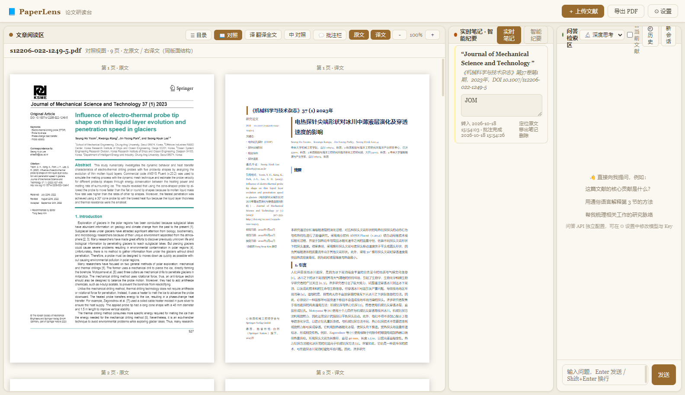
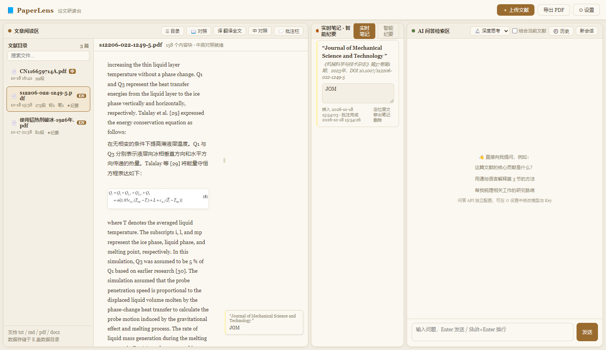
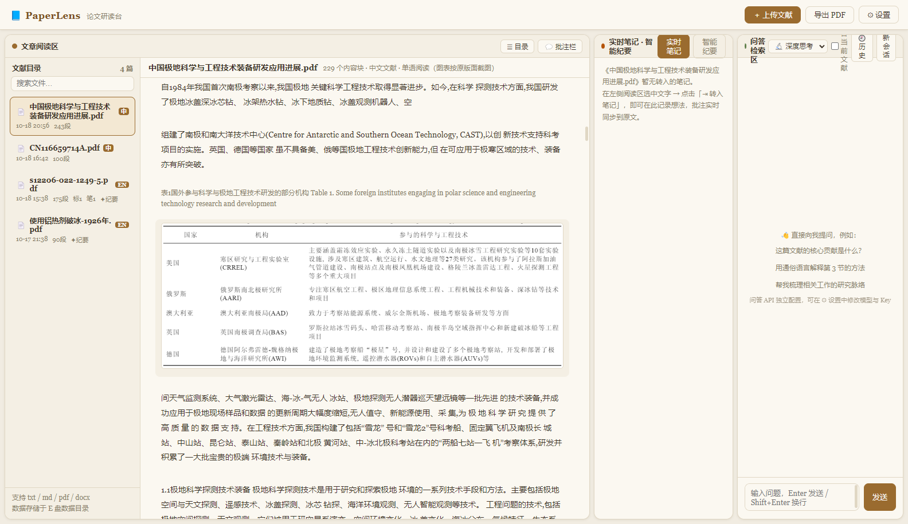

# 📘 PaperLens · 论文研读台

一款**本地运行的论文精读工具**，参照 Google NotebookLM 的思路设计：左边读文献、中间做笔记、右边问 AI。

相比通用 PDF 阅读器，PaperLens 的重点在「读懂外文文献」——它会把 PDF 拆成**结构化内容块**（标题 / 正文 / 列表 / 图注 / 公式 / 图 / 表），逐块翻译成中文，并按原文版式重新排版，形成**逐段对应的中英对照**；图片、表格、公式一律从原页面**按区域截取**，不重排、不丢内容。



---

## ✨ 主要功能

### ① 文章阅读区
- **两种视图**
  - **原文视图**：按原版面逐页渲染 PDF，可划词、可标注、可缩放
  - **对照视图**（外文文献）：左原文页 / 右**译文重建页**，译文按原文坐标重排，标题层级、分栏、列表、公式、图表结构与原版面一一对应
- **结构化中英对照**：按标题 / 段落 / 列表 / 图注分块翻译，译文与原文块一一对齐
- **图表公式按区域截图**：图片、表格、公式从原页面精确裁切后原位嵌入（OCR 碎片会被自动合并）
- **划词标注**：5 色高亮、批注、复制，中文译文侧同样可直接标注
- **中文文献**：自动识别语种，只提供原文视图，不做无意义的"译文对照"




### ② 实时笔记 · 智能纪要
- 阅读区划词 → 「转入笔记」→ 在中栏写想法，**批注实时同步回原文边栏**
- 每条记录保存「转入时间」与「批注完成时间」
- **智能纪要**：调用大模型流式生成结构化纪要（概括 / 背景 / 方法 / 结果 / 结论 / 局限 / 阅读建议），与文献绑定

### ③ AI 问答检索区
- 接入任意 OpenAI 兼容模型（默认 DeepSeek），流式输出
- 思考强度三档：快速 / 标准 / 深度思考
- 可勾选「结合当前文献」，把纪要、标注、批注作为上下文
- 问答历史自动留痕，重要会话可收藏

### 其他
- **导出 PDF**：含中英对照正文、图表、5 色标注、批注、实时笔记（带时间戳），文末附智能纪要
- **重复文件识别**：上传与导出按内容哈希查重，导入时可选择「按全新文件处理」
- **主题可换**：内置蓝色商务 / 深空夜读 / 米白纸感三套主题，支持自定义配色、背景图与 `theme.json` 主题包
- **三栏可调**：拖动分隔条调节三区宽度，自动记忆
- **纯本地**：文献、标注、译文全部存在本机，只有翻译/问答请求会发往你配置的模型 API

---

## 📦 下载与安装

前往 [Releases](../../releases) 下载：

| 文件 | 说明 |
|---|---|
| `PaperLens-x.y.z-setup.exe` | 安装版（NSIS），可自选安装目录，创建桌面快捷方式 |
| `PaperLens-x.y.z-portable.exe` | 便携版，双击即用，**数据保存在 exe 同级 `data` 目录**，适合放 U 盘或 E 盘 |

> 未做代码签名，首次运行 Windows SmartScreen 可能提示「未知发布者」，点「更多信息 → 仍要运行」即可。

### 从源码运行

```bash
git clone https://github.com/<your-name>/paperlens.git
cd paperlens
npm install
npm start          # 桌面版
# 或 node server/server.js 后用浏览器打开 http://127.0.0.1:8642
```

要求 Node.js ≥ 18。

---

## ⚙️ 首次配置

打开右上角 **⚙ 设置 → API 配置**，填写两组 Key（可相同）：

| 配置 | 用途 | 默认 |
|---|---|---|
| 📚 文献处理 API | 翻译 + 智能纪要 | `https://api.deepseek.com`，`deepseek-chat` |
| 💬 AI 问答 API | 问答区对话 | 同上，可独立配置 |

Key 仅保存在本机数据目录，不上传任何第三方。任何 OpenAI 兼容接口（DeepSeek / 通义 / Kimi / 本地 vLLM 等）改 Base URL 即可。

---

## 🚀 使用流程

1. **上传**：点「＋ 上传文献」或把 `.pdf / .docx / .md / .txt` 拖进窗口
2. **翻译**（外文）：点「译 翻译全文」，逐块进度实时显示
3. **阅读**：文本视图看结构化对照；点「📖 对照」看双栏还原版式；点「📄 原文」回到原版页面
4. **标注**：选中任意文字 → 选颜色 / 写批注 / 转入笔记
5. **纪要**：中栏切到「智能纪要」→ 生成
6. **导出**：右上角「导出 PDF」

---

## 💾 数据存储

| 版本 | 默认数据目录 |
|---|---|
| 开发运行 | `<项目>/data` |
| 便携版 | `<exe 所在目录>/data` |
| 安装版 | `%APPDATA%\PaperLens\data`（安装目录不可写时） |

可在 **设置 → 数据与存储** 中修改，指向 E 盘等任意位置；已有数据搬迁后改路径即可继续使用。

```
data/
├── library/            原始文献
├── files/<id>/         paragraphs.json / layout.json / annotations.json / summary.json / crops/
├── exports/            导出的 HTML 与 PDF
├── config.json         API Key、主题、布局（请勿提交到仓库）
└── chats.json          问答历史
```

---

## 🛠 从源码构建 exe

```bash
npm install
npm run dist        # 生成 dist/PaperLens-<version>-setup.exe 与 portable.exe
npm run dist:dir    # 只生成免安装目录 dist/win-unpacked/
```

图标位于 `build/icon.ico`，打包配置见 `package.json` 的 `build` 字段（electron-builder）。

---

## 🧱 目录结构

```
paperlens/
├─ electron/            桌面端主进程（窗口、PDF 导出、数据目录解析）
├─ server/
│  ├─ server.js         本地 HTTP 服务（文件/标注/翻译/纪要/问答/导出/主题）
│  └─ pdflayout.js      PDF 版面引擎（分栏、块判型、表格与图表区域）
├─ public/              前端（原生 ES Modules，无构建步骤）
│  ├─ js/reader.js      阅读区：文本视图 / 对照视图 / 原文视图 / 标注
│  ├─ js/notes.js       实时笔记与智能纪要
│  ├─ js/chat.js        AI 问答
│  └─ css/app.css       主题变量驱动的样式
├─ themes/              三套预设主题
├─ build/               图标等打包资源
└─ docs/                README 截图
```

## 🔬 技术要点

- **版面分析**：pdf.js 取文本项与绘制指令 → 覆盖度直方图分栏 → 按基线/字号聚段 → 判型（标题层级、列表、图注、公式、图、表、页眉页脚）→ 表格按横线 + 行列校验识别 → 输出 `layout.json`（每个块的精确 bbox）
- **结构化翻译**：文本块按类型打包成 JSON 送模型，要求返回同结构 `[{id, zh}]`；标题保留编号、图注统一编号、表格保持行列；跨栏/跨页续段带上下文（`ctx`）衔接
- **译文重建页**：译文块以原文 bbox 绝对定位，同栏顺推避免重叠，通栏元素切分横带，页面溢出时等比缩字号，保证左右页版式对齐
- **图表截图**：前端离屏渲染整页 → 按区域裁切 → 落盘 `crops/` → 原位替换占位图

---

## ⚠️ 已知限制

- **扫描版 PDF**：无文字层时无法抽取，请先 OCR；OCR 质量差的文本层会出现断词、公式碎片（已做碎片合并与上下文补译，但仍建议使用文字版 PDF）
- **纯文字公式**：PDF 中以文本排版的公式按区域截图呈现，不做 MathML 重排
- **表格**：为保证保真，一律以原图呈现，不解析单元格文字
- 翻译与纪要质量取决于所配置的模型

---

## 📄 许可

[MIT](LICENSE)

## 免责声明

- 本工具仅供个人学习与研究使用，请遵守所阅读文献的版权与数据库使用条款，勿用于传播受版权保护的内容。
- 翻译、问答依赖第三方大模型 API，相关费用与合规责任由使用者自行承担。
- 本项目与 Google NotebookLM、DeepSeek 等无隶属关系。
